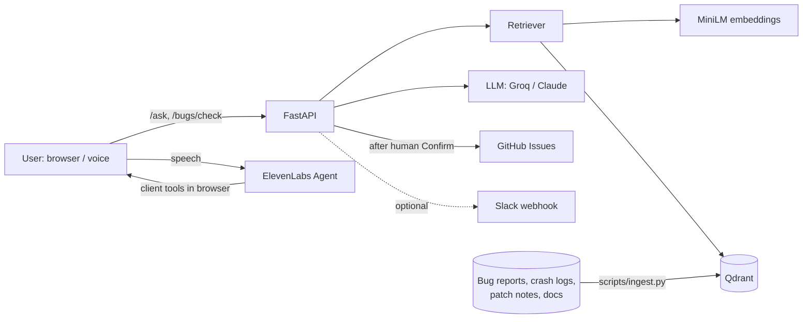

# StudioDesk

**An AI support and QA agent for game studios.** StudioDesk answers player and developer questions from a studio's bug reports, crash logs, patch notes and docs, with cited sources, by text or voice. It also catches duplicate bug reports, and it files new ones as GitHub Issues only after a human confirms.

It ships with a measured evaluation suite and a security review for every milestone.

> Demo data is a fictional game, **Starfall Outpost**: a co-op sci-fi survival game on PC, PS5, Xbox Series and Switch. The dataset has 66 bug reports, 25 crash logs, 10 patch notes and 4 support docs.

## What it does

| Feature | How |
|---|---|
| **Search** | Chunks and embeds every document (Hugging Face `all-MiniLM-L6-v2`) into **Qdrant**, with metadata filters for type, platform, version range, severity and component. |
| **Cited answers** (`/ask`) | Retrieval plus an LLM (Groq `openai/gpt-oss-120b` by default, Anthropic Claude optional). The server drops any citation that wasn't actually retrieved. |
| **Duplicate detection** (`/bugs/check`) | A similarity threshold shortlists candidates, then the LLM confirms. The response names the **original** report, not just the nearest match. |
| **Routing** | kNN over similar past bugs suggests component and severity labels. |
| **Confirmed actions** | A new bug gets an issue *preview* plus a single-use, 15-minute confirm token. Nothing is filed until a person clicks Confirm. Slack alerts are optional. |
| **Voice** (`/voice`) | An ElevenLabs Agent calls the same backend through two browser-side tools. The voice agent **cannot** file issues; only the on-screen Confirm button can. |

## Architecture



## Eval results

From `uv run python -m evals.run` (answerer `openai/gpt-oss-120b`, judge `qwen/qwen3.8-27b`, both on Groq). Full report: [`evals/reports/latest.md`](evals/reports/latest.md).

| Suite | Cases | Result |
|---|---|---|
| Retrieval | 25 new questions | hit@5 **1.00**, MRR 0.97 |
| Answers | 15 answerable + 5 unanswerable | citation validity **1.00**, fact recall 0.93, groundedness 0.88, correct refusals 5/5 |
| Duplicates (held-out) | 22 unseen cases | precision **1.00** / recall **1.00** |
| Duplicates (calibration) | 23 cases | precision 0.94 / recall 1.00 |
| Routing (kNN) | 76 bugs | component accuracy 0.57 (the weakest area; see below) |
| Prompt injection | 14 attacks | **14/14** passed: no leaks, no fake citations, no forced verdicts, no actions |

## Quickstart

Requires Python 3.12 and [uv](https://docs.astral.sh/uv/).

```bash
git clone https://github.com/raksharakyan/studiodesk && cd studiodesk
uv sync
cp .env.example .env        # then fill in the keys you need (see below)
uv run python scripts/validate_dataset.py
uv run python scripts/ingest.py --recreate
uv run uvicorn studiodesk.main:app --reload
```

Open http://localhost:8000/docs for the API or http://localhost:8000/voice for the voice page.

### Keys

All keys live in `.env`, which is gitignored. `.env.example` lists every setting. Every service has a free tier.

| Variable | Needed for | Where to get it |
|---|---|---|
| `QDRANT_URL`, `QDRANT_API_KEY` | Qdrant Cloud. Leave empty to use embedded local mode. | cloud.qdrant.io (free cluster) |
| `GROQ_API_KEY` | `/ask`, `/bugs/check` | console.groq.com |
| `GITHUB_TOKEN`, `GITHUB_REPO` | Filing issues | Fine-grained PAT: one repo, **Issues: Read and write** only |
| `ELEVENLABS_API_KEY`, `ELEVENLABS_AGENT_ID` | Voice | Key restricted to **ElevenAgents: Write**; then `uv run python scripts/setup_voice_agent.py --allow-host localhost` prints the agent id |
| `SLACK_WEBHOOK_URL` | Optional alerts | Slack incoming webhook |

Issue filing and voice are **off by default** when `APP_ENV=prod` (`ACTIONS_ENABLED`, `VOICE_ENABLED`). Both have daily caps.

## Development

```bash
uv run pytest -q                       # ~1,480 tests, all offline (fakes for LLM, GitHub, Qdrant, ElevenLabs)
uv run ruff check . && uv run mypy src # lint + strict typing
uv run python -m evals.run --strict    # live evals (needs keys); --offline runs the harness with fakes
uvx pip-audit                          # dependency audit
```

CI (GitHub Actions) runs lint, format, mypy, tests, dataset validation, the offline eval harness and dependency audits on every push.

## Security

- Secrets are only ever read from the environment as `SecretStr` and are redacted from logs. Scans show no keys in the code or git history.
- Retrieved documents and user input are treated as **untrusted data**: they're delimited in prompts, the system prompt says to ignore instructions inside them, and the dataset includes planted injection attacks that the evals check.
- No model output ever reaches an outward action. Issue titles and bodies are built server-side from the user's fields, and user text is fenced.
- Endpoints have per-IP rate limits, request-size limits and LLM concurrency and time limits. The voice page uses a strict CSP and a pinned SDK with an SRI hash.
- Each milestone has a written review in [`docs/security/`](docs/security/).

## Project layout

```
src/studiodesk/   app: api/, agent/ (answer, duplicates, routing), llm/, actions/, voice/, ingest/, static/
data/synthetic/   Starfall Outpost dataset
evals/            eval cases, harness, reports
scripts/          ingest, dataset validation, issue labels, voice agent setup
voice/agent.json  ElevenLabs agent config as code
docs/security/    per-milestone security reviews
```

## Status and next steps

Done: ingestion and search, cited answers, duplicate detection, confirmed actions, evals, voice. In progress: the main web UI and deployment (Railway/Render), plus fuller docs.

Known weak spots:
- kNN routing accuracy is 0.57; an LLM or label-description classifier is the next experiment.
- About 60% of answers are fully grounded; the judge is strict about generic advice.
- Groq's free tier allows 8,000 tokens per minute, which limits throughput.

Built with Claude Code using specialist dev, QA, security and UI subagents.
