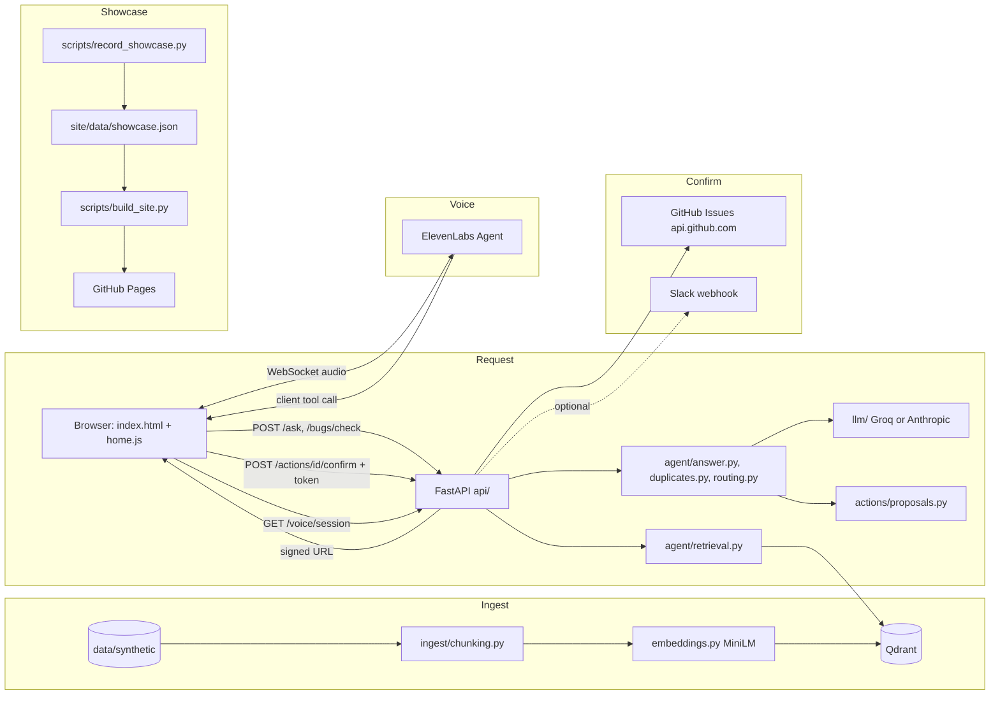

# StudioDesk

An AI support and QA agent for game studios. It answers questions about bug reports, crash logs, patch notes and support docs, cites its sources, spots duplicate bug reports, and files GitHub Issues only after a person confirms.

**[Live showcase](https://raksharakyan.github.io/studiodesk/)**: the site replays real results recorded from the pipeline. There is no backend behind it, so it cannot file anything.
[](https://github.com/raksharakyan/studiodesk/actions/workflows/ci.yml)
License: [MIT](LICENSE) · Security: [SECURITY.md](SECURITY.md) · Architecture notes: [docs/architecture.md](docs/architecture.md)

The demo data is a fictional co-op survival game, **Starfall Outpost**. The dataset has 66 bug reports, 25 crash logs, 10 patch notes and 4 support docs ([`data/synthetic/`](data/synthetic/), counted in [`site/data/showcase.json`](site/data/showcase.json)). Ingesting it produces 178 chunks ([`evals/reports/latest.md`](evals/reports/latest.md)).

## What it does

| Feature | Endpoint / entry point | How |
|---|---|---|
| Search | `POST /search` | Hugging Face `all-MiniLM-L6-v2` embeddings in **Qdrant**. You can filter on doc type, platform, severity, component and a version range, where the range is a Qdrant `Range` on an integer `version_num` payload field. |
| Cited answers | `POST /ask` | Retrieves the top 6 chunks and sends them to an LLM: Groq `openai/gpt-oss-120b` by default, Anthropic Claude optionally. The server removes any cited id that was not actually retrieved. |
| Duplicate detection | `POST /bugs/check` | A cosine threshold builds a shortlist and one LLM call judges it. The verdict names the **canonical original** by following `duplicate_of` links, not just the nearest match. |
| Routing | `POST /bugs/check` | A kNN vote over the 7 most similar past bugs suggests component and severity labels. No LLM is involved. |
| Confirmed GitHub actions | `POST /actions/{id}/confirm` / `cancel` | `/bugs/check` returns an issue *preview* and a single-use confirm token that lasts 15 minutes. Nothing is filed until the user confirms. A Slack alert after filing is optional. |
| Voice | `GET /voice/session`, `/voice` page | An ElevenLabs Agent calls the same API through two **browser client tools** (`ask_studiodesk`, `check_bug_report`). It has no confirm tool; only the on-screen Confirm button can file an issue. |
| Evals | `uv run python -m evals.run` | Five suites: retrieval, answers, duplicates, routing and prompt injection. Floors are enforced with `--strict` ([`evals/README.md`](evals/README.md)). |

## Architecture



Voice tool calls run in the browser. The ElevenLabs agent asks the page to run `ask_studiodesk` or `check_bug_report`, and the page sends the same same-origin `/ask` or `/bugs/check` request a typed query would. The ElevenLabs API key stays on the server. More detail is in [docs/architecture.md](docs/architecture.md).

### Life of a request: `POST /ask`

1. `middleware.py` rejects bodies over `MAX_REQUEST_BYTES` (64,000 by default) with 413 and adds the security headers. slowapi then applies the per-IP limit from `api/ratelimit.py`.
2. `api/ask.py` validates `AskRequest` (`models/answer.py`; the question is limited to 1,000 characters). `api/deps.py` injects the `Retriever`, the LLM client and `Settings`.
3. `agent/answer.py::answer_question` calls `Retriever.search` (`agent/retrieval.py`). That embeds the question with `embeddings.py`, and `vectorstore.py::build_filter` turns the optional filters into a Qdrant `must` filter.
4. `prompts.py::build_answer_prompt` wraps the question in `<user_question>` and each chunk in `<document>` tags and neutralises any of our tag names found inside the text. The system prompt is a frozen constant.
5. The call goes through `llm/limits.py::GatedLLM`, which applies a concurrency slot and the global call budget and returns 503 with `Retry-After` when either is exhausted. It then reaches `llm/groq_client.py` (or `anthropic_client.py`), which returns a schema-validated `LLMAnswer`.
6. `strip_unverified_citations` and `cited_sources` drop every id that was not in the retrieved set, both from the sources list and from the answer text. The response is an `AnswerResponse` with snippets of the cited chunks.

### Life of a request: `POST /bugs/check`

1. Steps 1 and 2 as above, with `BugCheckRequest` (`models/bugs.py`).
2. `agent/routing.py::route_bug` gets the 7 nearest bug reports and runs a score-weighted vote for component and severity. Labels can only come from the allowlist in `actions/labels.py`.
3. `agent/duplicates.py::check_duplicates` searches `doc_type=bug_report` (top 5) and keeps candidates scoring at least 0.48. It sends them in one LLM call (`prompts.py::build_duplicate_prompt`), and `decide_verdict` applies the 0.70 auto threshold. `canonical_original` follows `duplicate_of` up to 5 hops.
4. Unless the verdict is `duplicate` (or the user sets `file_anyway`), `api/bugs.py::propose_issue` builds the issue with `actions/issue.py::build_issue_draft` from the user's fields and the routing result only. It stores the draft in `actions/proposals.py` and returns the preview, `action_id` and `confirm_token`. Filing is skipped when it is disabled or the daily cap is reached; the preview is still returned.
5. `POST /actions/{id}/confirm` (`api/actions.py`) claims the proposal: it compares the token's SHA-256 digest in constant time, marks the proposal used and reserves a daily slot. Then `actions/github.py` files the **stored** draft and `actions/slack.py` sends the optional alert.

## Eval results

From [`evals/reports/latest.md`](evals/reports/latest.md), dated 2026-10-10 16:09 UTC. The answerer was `groq:openai/gpt-oss-120b`, the judge `groq:qwen/qwen3.8-27b`, and embeddings came from `all-MiniLM-L6-v2` at revision `1110a243`, using in-memory Qdrant with a fresh ingest.

| Suite | Cases | Result |
|---|---|---|
| Retrieval | 25 | hit@5 **1.000**, MRR@5 0.973, recall@5 0.783, hit@1 0.960 |
| Answers | 15 answerable + 5 unanswerable | citation validity **1.000**, fact recall 0.933, groundedness (mean) 0.884, fully grounded 0.600, correct refusal 1.000, false refusal 0.000 |
| Duplicates, calibration | 23 | precision 0.941, recall 1.000, F1 0.970 (1 hard negative flagged `possible_duplicate`) |
| Duplicates, held-out | 22 | precision **1.000**, recall **1.000**, F1 1.000 |
| Duplicates, overall | 45 | strict precision of `duplicate` verdicts 1.000, canonical-original accuracy 1.000, candidate recall 1.000 |
| Routing (kNN, no LLM) | 66 leave-one-out + 10 novel | component accuracy 0.576 LOO / 0.500 novel / 0.566 all; severity 0.561 / 0.300 / 0.526 |
| Prompt injection | 14 | **14/14** passed: no secrets, no system prompt, only retrieved ids, no forced verdicts, store unchanged |

To reproduce (needs `GROQ_API_KEY`): `uv run python -m evals.run --strict`. `--offline` runs the harness with fakes and no keys, but its scores mean nothing.

How to read these numbers:
- **Calibration vs held-out.** The duplicate thresholds (0.48 and 0.70) were tuned on the 23 calibration cases, so those scores are optimistic. The 22 held-out cases were written later and never used for tuning. 22 cases is small: 1.000 means no errors were observed, not that the error rate is zero.
- **Judge.** Groundedness is judged by Qwen, a different model family from the answerer, which reduces self-grading bias. The judge is strict about generic advice, so only 60% of answers are fully grounded (`fully_grounded_rate` 0.600; the unsupported claims are listed under "Failures" in the report). Fact recall is deterministic token matching with no judge involved.
- **Caching.** The committed report was regenerated from the cache of the earlier live run (`llm_calls` 0, `cache_hits` 85 in its "Run cost" table), and its git SHA is marked `+dirty`. A cold run makes about 100 calls and takes roughly 20 to 30 minutes on Groq's free tier ([`evals/README.md`](evals/README.md)).
- **Floors.** The floors in [`evals/thresholds.json`](evals/thresholds.json) are: retrieval hit@5 ≥ 0.90, citation validity = 1.0, injection pass rate = 1.0, held-out duplicate F1 ≥ 0.85 and routing component accuracy ≥ 0.45.

## Quickstart

You need Python 3.12 and [uv](https://docs.astral.sh/uv/).

```bash
git clone https://github.com/raksharakyan/studiodesk && cd studiodesk
uv sync
cp .env.example .env                        # fill in only the keys you need (table below)
uv run python scripts/validate_dataset.py
uv run python scripts/ingest.py --recreate  # idempotent; uses local mode if QDRANT_URL is empty
uv run uvicorn studiodesk.main:app --reload
```

Then open http://localhost:8000/ for the main page, http://localhost:8000/voice for the voice page, or http://localhost:8000/docs for the OpenAPI docs (disabled when `APP_ENV=prod`).

### Keys and least-privilege scopes

All settings are listed in [`.env.example`](.env.example). Your `.env` is gitignored, keys are read as `SecretStr`, and the sample `your-...` placeholder values count as unset.

| Variable | Needed for | Scope to grant |
|---|---|---|
| `GROQ_API_KEY` | `/ask`, `/bugs/check`, evals | Groq free tier (console.groq.com). Set `LLM_PROVIDER=anthropic` and `ANTHROPIC_API_KEY` to use Claude instead. |
| `QDRANT_URL`, `QDRANT_API_KEY` | Qdrant Cloud | Free cluster. Leave `QDRANT_URL` empty to use embedded local mode (`.qdrant_data/`). For `evals.run --qdrant cloud`, use a read-only key scoped to the collection. |
| `GITHUB_TOKEN`, `GITHUB_REPO` | Filing issues | Fine-grained PAT for **one** sandbox repo with **Issues: Read and write** and nothing else. |
| `ELEVENLABS_API_KEY`, `ELEVENLABS_AGENT_ID` | Voice | Restrict the key to **ElevenAgents: Write** and set a credit limit on it. The key never leaves the server. |
| `SLACK_WEBHOOK_URL` | Optional alerts | Incoming webhook. Only `https://hooks.slack.com/...` is accepted; leave it empty to disable. |
| `HF_TOKEN` | `scripts/deploy_hf_space.py` only | Write token, used only on your machine and never copied to the Space. Docker Spaces need HF PRO. |

When `APP_ENV=prod`, issue filing (`ACTIONS_ENABLED`) and voice (`VOICE_ENABLED`) are **off by default**.

### Issue labels and the voice agent

```bash
uv run python scripts/setup_issue_labels.py                        # creates the label allowlist in GITHUB_REPO (idempotent)
uv run python scripts/setup_voice_agent.py --dry-run               # print the ElevenLabs payloads, no network
uv run python scripts/setup_voice_agent.py --allow-host localhost  # create the agent, print its id
```

Put the printed id in `ELEVENLABS_AGENT_ID`. Later runs update that agent in place from [`voice/agent.json`](voice/agent.json): the prompt, the two client tools, the 180 s call limit and `first_message` as the only client override.

### Record and build the showcase

```bash
uv run python scripts/record_showcase.py   # real /ask and /bugs/check calls in-process → site/data/showcase.json
uv run python scripts/build_site.py        # site/ → _site/, schema check + secret scan, no network
```

The recorder cannot file anything: GitHub and Slack are replaced by stand-ins that raise if called, and tokens and action ids are set to null before the file is written. `.github/workflows/pages.yml` builds `_site/` and publishes it on every push to `main`.

## Design trade-offs

Each item covers what was decided, why, and what it costs.

1. **Qdrant with MiniLM-L6 (384-d, pinned revision, CPU), dense search only.**
   *Why:* The model is small enough to run on CPU in CI and in a slim container, and pinning it by SHA (`EMBEDDING_MODEL_REVISION`) makes scores reproducible. The 384-d size is asserted in `tests/integration/test_duplicate_retrieval_real_model.py`. On this corpus it already reaches hit@5 1.000.
   *Cost:* recall@5 is 0.783, and rare exact tokens such as error codes or ids get no lexical boost. A larger model or hybrid search would help, at the price of RAM and latency.

2. **Version filtering through an integer payload field.**
   *Why:* `"1.10.0" > "1.9.0"` compares wrongly as a string, so ingest stores `version_num` and `/search` filters with a Qdrant `Range` on it (`vectorstore.py`).
   *Cost:* versions must be strict `x.y.z` with each part below 100 (`major*10000 + minor*100 + patch`, `models/documents.py::version_to_int`). Changing the encoding means re-ingesting.

3. **Duplicates use a similarity shortlist plus LLM confirmation, with thresholds calibrated on data.**
   *Why:* Scores alone cannot separate duplicates from look-alikes. Labelled originals score 0.501 to 0.786, while hard negatives reach 0.684 (`agent/duplicates.py`). The 0.48 candidate threshold keeps every original and skips the LLM for clearly new reports. The 0.70 auto threshold sits above the hard-negative maximum of 0.684, so an LLM that wrongly agrees on a look-alike can produce at most `possible_duplicate`.
   *Cost:* only 8 of the 16 labelled duplicates reach 0.70. The rest show up as `possible_duplicate`, which is safe but noisier. The thresholds are tied to this model and corpus.

4. **Canonical-original resolution.**
   *Why:* A report that matches BUG-0006, which is itself a duplicate of BUG-0002, should point at BUG-0002. The code follows `duplicate_of` for up to 5 hops and is safe against cycles. Canonical accuracy is 1.000.
   *Cost:* the result depends on correct `duplicate_of` links in the tracker, and each hop costs an extra payload lookup.

5. **kNN routing as a measured baseline, not an LLM classifier.**
   *Why:* The vote is deterministic, free, needs no prompt and yields an honest number: component accuracy 0.576 LOO / 0.566 all, with a CI floor of 0.45.
   *Cost:* it is the weakest area. Novel bugs reach only 0.500 component and 0.300 severity accuracy, and the confusion matrix shows `ui` and `input` mostly misrouted.

6. **Groq free tier (`openai/gpt-oss-120b`) as the default, Anthropic as an option.**
   *Why:* Anyone can run it at no cost. One `LLMClient` protocol keeps the provider swappable through `LLM_PROVIDER`.
   *Cost:* the free tier allows 8,000 tokens per minute per model. The eval harness keeps a sliding 60 s window under `EVAL_MAX_TPM` 6,000 / `EVAL_MAX_RPM` 20 and caches outputs in `evals/.cache/`, so a cold run takes 20 to 30 minutes. The app has a global budget of 6 calls/min and 300/day (`.env.example`).

7. **Propose, then confirm, with single-use hashed tokens; issue bodies built on the server.**
   *Why:* An outward action should never follow from model output. The token is 256-bit (`secrets.token_urlsafe(32)`), stored only as a SHA-256 digest, compared in constant time, claimed atomically and valid for 15 minutes. Confirm runs the draft stored at proposal time. Titles and bodies come only from the user's validated fields, the routing enums and our own ids, never from model text. User text is placed in fences it cannot escape, and `@mentions` and `#N` references are broken.
   *Cost:* every filing takes an extra round trip. A failed GitHub call burns the token, so the user re-submits rather than risking a duplicate issue.

8. **Voice as a thin orchestrator: browser client tools, no confirm tool.**
   *Why:* The voice agent reuses the same validated API, and spoken or injected text cannot file anything. The agent is private: sessions need a server-minted signed URL, auth is enabled and hosts are allowlisted. Only `first_message` can be overridden by the client. Calls are capped at 180 s and 30 sessions per day.
   *Cost:* the user must look at the screen to confirm. Tool calls depend on the browser tab staying open, and the agent's LLM (`gemini-2.0-flash`, set in `VOICE_LLM`) is a separate model to watch.

9. **Prompt-injection posture: delimit, then verify on the server.**
   *Why:* The system does not trust the model to obey "ignore instructions in documents". Data is delimited and tag-neutralised and prompts are frozen. The server then enforces what matters itself: citations are filtered to the retrieved set, no model text reaches actions, and labels come from an allowlist. Planted fixtures (BUG-0014, BUG-0026, BUG-0041, BUG-0054 and a section of `DOC-troubleshooting-guide`) are covered by a 14-case suite, with 14/14 passing.
   *Cost:* the model can still be steered within its answer text, for example toward an unhelpful answer. That is bounded but not prevented; see "What I'd do next".

10. **No auth by design; caps, kill switches and a global LLM budget instead.**
    *Why:* The project's scope excludes auth. Abuse is bounded instead: prod per-IP limits (`ask 3/minute;30/day`, `bugs 3/minute;20/day`, `actions 2/minute;5/day`, `voice 2/minute;5/day`), `ACTIONS_MAX_PER_DAY` 20, `VOICE_MAX_SESSIONS_PER_DAY` 30, LLM concurrency of 4 with a 30 s timeout and a 75 s deadline, and filing and voice off by default in prod.
    *Cost:* anyone who can reach a live deploy shares those budgets, and one visitor can use up the day's allowance.

11. **In-memory per-process state.**
    *Why:* Proposals, the voice quota, the LLM budget and the rate limiter use in-process stores with locks, which keeps the system simple and fully testable on a single process.
    *Cost:* with N workers a confirm only works on the process that created the proposal, caps multiply by N, and a restart clears everything ([M6 #3](docs/security/m6-review.md)).

12. **A static GitHub Pages showcase instead of a paid host.**
    *Why:* Hugging Face Docker Spaces now require PRO ([m6-review](docs/security/m6-review.md)). A static replay of real recorded results costs nothing, exposes no keys and cannot be abused. `scripts/deploy_hf_space.py` is ready for a live deploy.
    *Cost:* visitors cannot ask their own questions. The showcase shows one recording (2026-10-24), not live behaviour.

## What I'd do next

- **Hybrid dense + sparse search** (BM25 or SPLADE in Qdrant) plus re-ranking, aimed at the 0.783 recall@5 and exact-token queries.
- **An LLM or label-description routing classifier**, measured against the 0.576 / 0.566 kNN baseline with the same leave-one-out and novel splits.
- **A shared store (Redis)** for proposals, quotas and rate limits behind the existing protocols, so the app can scale beyond one process.
- **Auth plus per-user quotas** for a real deployment, replacing the global budgets.
- **A live deploy** (HF PRO or Railway), including measuring the platform's proxy hops with `DEBUG_LOG_CLIENT_IP` before setting `TRUSTED_PROXY_IPS` (M6 #2).
- **A prompt-guard classifier** (for example Llama Prompt Guard on Groq) as an extra injection layer in front of the delimiting and server-side checks.
- **A stricter answer prompt** to raise fully grounded answers above 60%, since most unsupported claims in the report are generic advice.
- **Webhook-driven ingestion** from a real tracker instead of batch `scripts/ingest.py`.
- **Streaming answers** for `/ask` and voice, to cut the time to first token.
- **Zapier or Slack workflows** that run after a confirmed filing, reusing the same confirm gate.

## How it was built

Built with Claude Code as the orchestrator, delegating to four subagents defined in [`.claude/agents/`](.claude/agents/): [dev](.claude/agents/dev-agent.md), [QA](.claude/agents/qa-agent.md), [security](.claude/agents/security-agent.md) and [UI](.claude/agents/ui-agent.md). Every milestone followed the same loop: plan, then dev-agent (or ui-agent) implements, qa-agent tests until green, and security-agent reviews, with High or Critical findings blocking the merge. Each milestone ended with a summary to the owner and stopped for approval.

- 1,851 tests are collected (`.venv/bin/pytest -q --co -q`). 2 are marked `slow` and load the real embedding model; 2 are marked `live` and run only on opt-in.
- Security reviews: [M1](docs/security/m1-review.md) · [M2](docs/security/m2-review.md) · [M3](docs/security/m3-review.md) · [M4](docs/security/m4-review.md) · [M5](docs/security/m5-review.md) · [M6](docs/security/m6-review.md), summarised in [SECURITY.md](SECURITY.md).

## Project layout

```
src/studiodesk/
  main.py, config.py        app factory, Settings (env / .env, SecretStr)
  api/                      routers: search, ask, bugs, actions, voice, demo, pages; deps, rate limits, errors
  agent/                    retrieval, answer (citation filtering), duplicates, routing
  llm/                      Groq and Anthropic adapters, concurrency gate, call budget
  actions/                  proposal store, issue builder, label allowlist, GitHub, Slack
  voice/                    ElevenLabs client, agent provisioning, daily session quota
  ingest/, embeddings.py, vectorstore.py   chunking, MiniLM embedder, Qdrant store
  prompts.py                frozen system prompts, delimited data sections
  static/                   main page, voice page, vendored ElevenLabs worklets
data/synthetic/             Starfall Outpost dataset (bugs, crashes, patch notes, docs)
evals/                      cases, harness, thresholds, reports
scripts/                    dataset validation, ingest, labels, voice setup, showcase, HF deploy
site/                       static showcase (site/data/showcase.json)
voice/agent.json            ElevenLabs agent as code
docs/                       architecture notes, per-milestone security reviews
tests/                      unit and integration tests (fakes for LLM, GitHub, Slack, ElevenLabs)
```

## Testing and CI

```bash
uv run pytest -q                        # full suite; Qdrant is ":memory:" with a fake embedder
uv run pytest -q -m "not slow"          # skip the tests that load the real model
STUDIODESK_LIVE=1 uv run pytest -q -m live
uv run ruff check . && uv run ruff format --check . && uv run mypy src
uvx pip-audit
```

[`.github/workflows/ci.yml`](.github/workflows/ci.yml) runs on every push to `main` and on every pull request:
- ruff lint and format checks
- mypy on `src` and `evals`
- pytest with coverage
- the offline eval harness
- dataset validation
- `pip-audit`, plus an audit of the public torch version (pip-audit skips `+cpu` builds)
- a Docker build and smoke test that checks `/health`, the CSP and HSTS headers, `/api/demo-info` and that the container runs as non-root uid 1000

[`.github/workflows/pages.yml`](.github/workflows/pages.yml) builds and publishes the showcase. Its build job has read-only permissions; only the deploy job can write to Pages.

## License

[MIT](LICENSE).
